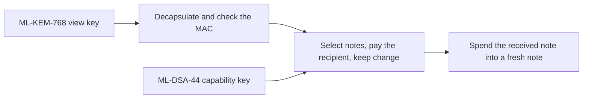
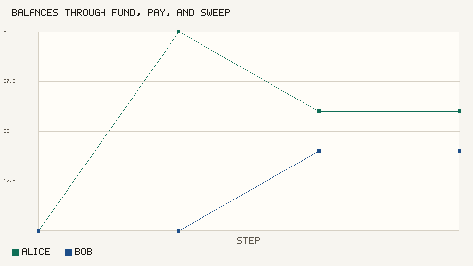
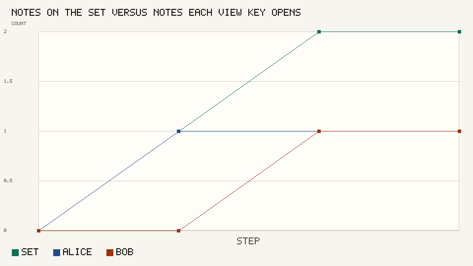
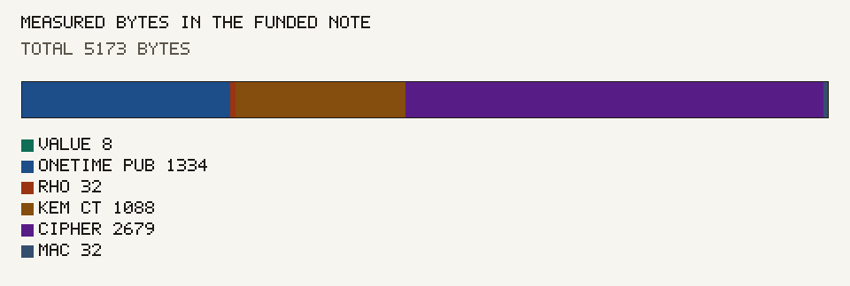
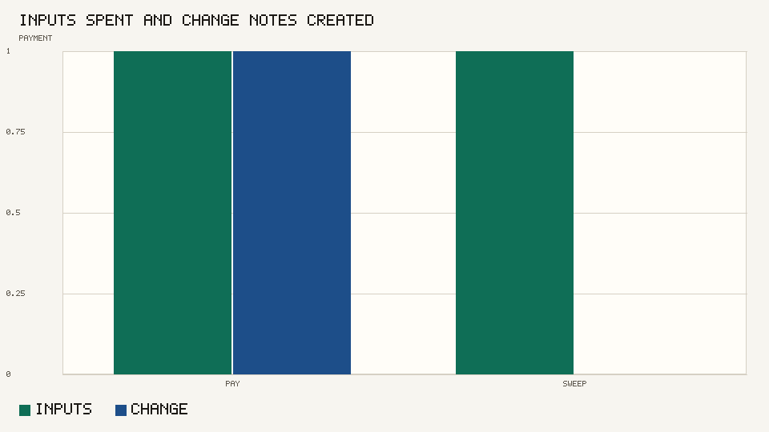

# Timecoin wallet

Wallet for the Timecoin testnet. The token is Timecoin. The ticker is TIC. Consensus is the node at <https://github.com/9lordisgod/Timecoin>. This repository builds notes, checks a transfer locally, and does not seal blocks.

Organization copy of the node: <https://github.com/Timechain-HQ/Timecoin>



A local ledger rejects a transfer whose inputs do not equal its outputs plus the fee, and a transfer whose one-time key does not sign the sighash. The node checks the same transfer again inside a block.

```bash
python3 -m unittest tests.test_wallet
python3 -m tcwallet.cli charts
```

The chart session funds 50 TIC, pays 20 TIC with a 500 base-unit fee, then sweeps. The local ledger removes that fee from the note set. The node pays the same fee into the coinbase. Bob's swept note does not open under Alice's view key.









The table is in [docs/charts/README.md](docs/charts/README.md). Protocol text is in the [book](https://github.com/Timechain-HQ/book).
